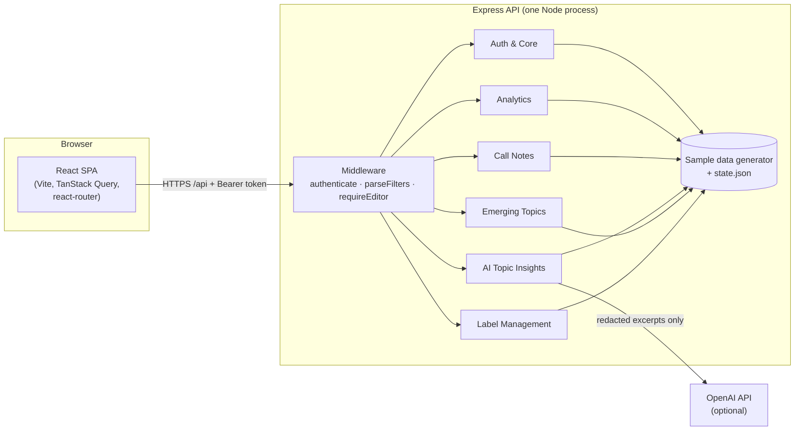
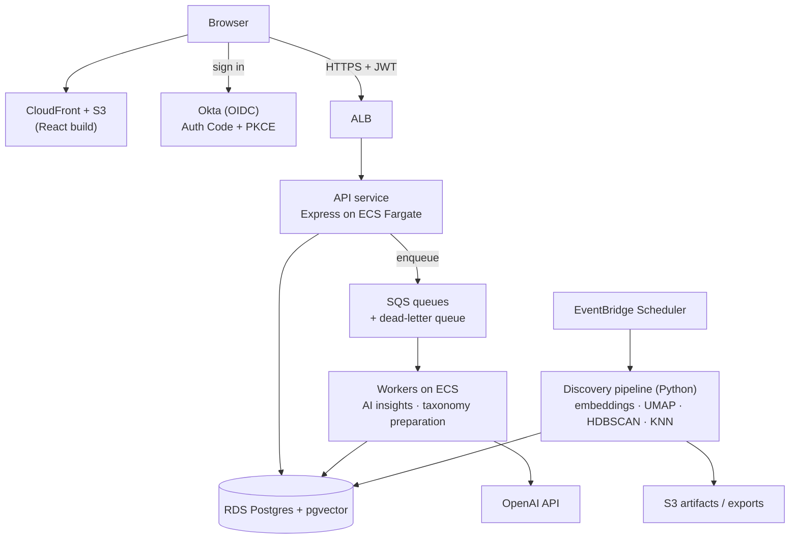

# Call Topic Insights — System Overview

This document describes what the system does, how it is put together, and what each service is
responsible for and built with. For coding conventions and cross-service contracts see
[`ARCHITECTURE.md`](./ARCHITECTURE.md); for setup and commands see the [README](../README.md).

> **Scope note.** Sections 1–4 describe the code in this repository, which runs locally on
> deterministic sample data. Section 5 is the **production deployment design** (AWS, Okta, queues).
> It is a target architecture and is not implemented in this repo.

---

## 1. What the system is

Call Topic Insights is an internal web app that shows **why clients contact support**. Support notes
written after client calls are grouped into topics (parent topic → subtopic). Teams can:

- follow topic volumes and trends with consistent numbers on every page;
- drill down from any number to the underlying notes;
- generate **AI Topic Insights**: recurring issues with exact shares, source notes, a summary and hypotheses;
- review **emerging topics** when too many notes don't fit any known topic;
- maintain the **topic taxonomy** (rename / move / merge), then publish and activate new versions.

### Problems it solves

| Problem | How the system addresses it |
|---|---|
| Manually maintained tags fall behind; new issues land in "Other" | Unsupervised topic discovery + monitoring of the unassigned-notes rate surfaces new topics |
| No consistent trend numbers across teams | One filter contract (date range, taxonomy version, team) and one metrics module for every count |
| Going from a number to the cause means reading notes by hand | Drill-down to notes, plus AI summaries whose every number traces back to source notes |

### Users and roles

| Role | Example account | Can do |
|---|---|---|
| **Editor** | Alex Chen | See all teams; review emerging topics; edit, publish and activate taxonomy versions |
| **Viewer** | Jordan Lee | See only their own team's data (Money Movement); read-only |

---

## 2. Architecture

### 2.1 Repository layout

The repo is an **npm workspaces monorepo** with three packages:

| Package | Contents | Tech |
|---|---|---|
| `shared/` | Request/response types shared by API and web app | TypeScript (types only) |
| `backend/` | REST API, business logic, sample data, persisted state | Node.js, Express 4, TypeScript (`tsx`) |
| `frontend/` | Single-page web app | React 18, Vite 5, TypeScript |

### 2.2 Runtime architecture (current implementation)

Key points:

- **Modular monolith.** All services run in one Express process and deploy together, but each service
  owns its own route file, service file, state slice, shared types file, frontend folder and stylesheet.
  Services call each other only through a few named functions (listed in `ARCHITECTURE.md`), so they
  can be split out along the same boundaries later.
- **One request pipeline.** Every `/api` call (except sign-in and health) goes through
  `authenticate` → route → `parseFilters` (validates `range` / `version` / `team` and team access) →
  service. Editor-only routes add `requireEditor`.
- **Async jobs.** Slow work (AI insights, topic discovery, taxonomy preparation) runs as background jobs
  with a status state machine. The API returns a job id immediately and the frontend polls.
- **Persistence.** Mutable state (versions, drafts, decisions, jobs, reports) is kept in memory and saved
  to `backend/data/state.json`. Note data itself is generated deterministically, so the same note always
  has the same ID, date, text and topic.
- **Errors.** All errors use one shape: `{ "error": { "code", "message" } }`, thrown as `HttpError`.

### 2.3 Frontend architecture

| Concern | Approach | Tech |
|---|---|---|
| Routing | One page component per route | react-router-dom 6 |
| Server state | Caching, retries, invalidation after mutations, polling for jobs | @tanstack/react-query 5 |
| Filter state | `range`, `version`, `team`, paging and sorting live in the URL (shareable, works with Back) | `useFilters` hook + URL search params |
| UI state | Auth, note drawer, toasts | React Context |
| Styling | Design tokens as CSS variables + one stylesheet per service | Plain CSS (`tokens.css`, `app.css`, `notes.css`, `ai.css`, …) |
| Charts | Hand-drawn, responsive | SVG + ResizeObserver (`LineChart`, `BarList`) |
| Forms & dialogs | Controlled native inputs; accessible dialogs | Custom `Modal` (focus trap, Escape), `ConfirmDialog` |
| API access | `fetch` wrapper that adds the session token and signs out on 401 | `api/client.ts` |

---

## 3. Services

Each service below lists what it does, its API, and how it is built. All backend services are
TypeScript modules in the Express app; all frontend parts are React + TypeScript.

### 3.1 Auth & Core

**What it does**
- Email + password sign-in with test accounts; issues a session token.
- Returns the signed-in user, the filter options (ranges, versions, teams), and navigation badges.
- Enforces authentication, roles and team-scoped data access for every other service.

**API**

| Method | Path | Purpose |
|---|---|---|
| `POST` | `/api/auth/login` | Sign in; returns `{ token, expiresAt, user }` |
| `GET` | `/api/me` | Current user |
| `GET` | `/api/meta` | Filter options, active taxonomy version, badge counts |
| `GET` | `/api/health` | Health check (no auth) |

**How it is built**
- `backend/src/auth.ts`
  - passwords stored as **scrypt** hashes (per-account salt), compared with `timingSafeEqual`;
  - same 401 message for wrong password and unknown email; 5 failures lock an email for 5 minutes (429);
  - stateless session token `userId.expiresAt.signature`, signed with **HMAC-SHA256** (`CTI_SESSION_SECRET`), valid 12 hours;
  - `authenticate` and `requireEditor` middleware.
- `backend/src/filters.ts`: `parseFilters` validates filters and team access (403 `forbidden_team`).
- Frontend: `auth/AuthContext.tsx` (sign-in, sign-out, session-expiry handling), `pages/SignIn.tsx`.
- Node built-ins only (`node:crypto`); no auth library.

### 3.2 Analytics

**What it does**
- Overview dashboard: total notes in scope, topic ranking, fastest-growing subtopics, share of notes
  without a topic, comparison with the previous period.
- Topics list and topic detail: parent topics and subtopics with counts, change, trend series and
  representative notes.
- Guarantees that the same number is identical on every page for the same filters.

**API**

| Method | Path | Purpose |
|---|---|---|
| `GET` | `/api/overview` | Overview aggregates for the current filters |
| `GET` | `/api/topics` | All topics with counts and change |
| `GET` | `/api/topics/:topicId` | One topic: subtopics, trend series, example notes |

**How it is built**
- `services/metrics.ts`: the single place that computes counts, previous-period counts and change %.
- `services/overview.ts`, `services/topics.ts`: build responses from `metrics`.
- Taxonomy version is a filter, so historical numbers can be reproduced under older versions.
- Frontend: `pages/Overview.tsx`, `pages/Topics.tsx`, `pages/TopicDetail.tsx`, `components/FilterBar.tsx`,
  `components/charts/*`; queries keyed by the filters so changing a filter refetches automatically.
- Tech: Express + TypeScript; React Query; hand-drawn SVG charts.

### 3.3 Call Notes

**What it does**
- Paged list of support notes for a topic or subtopic, filterable by classification status and keyword,
  sortable by newest, oldest or most typical (similarity to the cluster centre).
- Note detail in a side drawer that can be opened from any page.
- Report an incorrect classification (a correction signal for the classifier).
- Plain-language search across notes.
- CSV export and topic digest subscriptions.
- Shows only the notes behind one AI finding when opened from AI Topic Insights.

**API**

| Method | Path | Purpose |
|---|---|---|
| `GET` | `/api/notes` | Paged, filtered, sorted notes (optionally for one AI finding) |
| `GET` | `/api/notes/:id` | Note detail |
| `POST` | `/api/notes/:id/reports` | Report incorrect classification (returns `RPT-…`) |
| `GET` | `/api/search` | Search notes and matching subtopics |
| `POST` | `/api/exports` | Create a CSV export |
| `POST` / `DELETE` | `/api/digests` | Subscribe to / unsubscribe from a topic digest |

**How it is built**
- `services/notes.ts`, `services/search.ts`, `routes/notes.ts`; sample notes from `data/notes.ts`.
- **Stable note IDs**: each ID encodes its source and sequence and `findNote` decodes it, so the same
  note has the same ID in lists, search and AI sources.
- Notes are shown redacted (names, account numbers, contact details).
- Search is keyword/theme matching over the sample data; the production design is query embeddings +
  vector search.
- Frontend: `pages/Notes.tsx`, `pages/Search.tsx`, `components/NoteDrawer.tsx` (global context,
  restores focus on close), `components/topics/ExportDialog.tsx`, `DigestDialog.tsx`.
- Tech: Express + TypeScript; React Query; URL state for filters, sort and page.

### 3.4 AI Topic Insights

**What it does**
- For the current topic and filters, generates:
  - **recurring issues**, each with an exact share (e.g. "32% of 400 sampled notes") and openable source notes;
  - a 1–2 sentence **summary**;
  - 2 **hypotheses** worth investigating.
- Marks results out of date when filters change; collects helpful / report feedback.

**API**

| Method | Path | Purpose |
|---|---|---|
| `GET` | `/api/insights/scope` | How many notes are in scope and whether they will be sampled |
| `POST` | `/api/insights` | Start a generation job |
| `GET` | `/api/insights/:id` | Job status and result |
| `GET` | `/api/insights/latest` | Latest result for a scope |
| `POST` | `/api/insights/:id/feedback` | Helpful / not helpful |
| `POST` | `/api/insights/:id/reports` | Report a problem with a result |

**How it is built**
1. Collect notes in scope; fewer than 40 → `insufficient` (no forced answer).
2. Sample up to 400 notes evenly across the date range.
3. **Compute recurring issues, shares and source notes in code.** The LLM never produces numbers.
4. If `OPENAI_API_KEY` is set, send the issue list plus at most 60 redacted excerpts (240 characters
   each, no note IDs) to **OpenAI Chat Completions** (`gpt-4o-mini`, temperature 0.2, JSON mode) for the
   summary and hypotheses; validate the JSON. Without a key, use rule-based text.
5. Errors have codes and a Retry: `AI-TIMEOUT` (20 s, `AbortController`), `AI-NETWORK`, `AI-HTTP-xxx`, `AI-PARSE`.

- Backend: `services/insights.ts` (job state machine), `services/llm.ts` (OpenAI client using `fetch`).
- Frontend: `components/ai/AiInsightsPanel.tsx`, `useInsights.ts` (React Query polling).
- "View all supporting notes" links to Call Notes with the finding id (`findingNoteIds()` contract).

### 3.5 Emerging Topics

**What it does**
- Tracks the share of notes without a topic against a 5% threshold.
- Runs topic discovery (re-clustering) as a background task; shows candidate new topics.
- Lets editors review a candidate (sample notes, closest existing topics) and add it to the draft
  taxonomy, merge it into a topic, or dismiss it.
- Shows background tasks; failed tasks can be inspected (error code) and retried.

**API**

| Method | Path | Purpose |
|---|---|---|
| `GET` | `/api/emerging` | Unassigned rate, candidates, status |
| `GET` | `/api/candidates/:id` | Candidate detail |
| `POST` | `/api/candidates/:id/decision` | Add / merge / dismiss (editor) |
| `POST` | `/api/discovery/run` | Start topic discovery (editor) |
| `GET` | `/api/tasks` | Background tasks |
| `POST` | `/api/tasks/:id/retry` | Retry a failed task (editor) |

**How it is built**
- `services/emerging.ts`: task state machine (queued → running → completed / failed) advanced by a timer.
- Decisions call Label Management's `addDraftChange()`; the sidebar badge uses `candidatesNeedingReview()`.
- Frontend: `pages/Emerging.tsx`, `components/emerging/*` (status cards, candidate grid, review, tasks).
- The real clustering pipeline (embeddings, UMAP, HDBSCAN, KNN) is not in this repo; discovery is simulated.

### 3.6 Label Management

**What it does**
- Browse the taxonomy tree and topic details.
- Draft changes: rename, move, merge, add.
- Review all draft changes, publish a new version (runs a preparation task: embeddings → validation →
  ready), then activate it. Failed preparation can be retried.

**API**

| Method | Path | Purpose |
|---|---|---|
| `GET` | `/api/taxonomy/tree` | Taxonomy tree |
| `GET` | `/api/taxonomy/topics/:id` | One topic in the taxonomy |
| `GET` | `/api/taxonomy/compare` | Active vs. draft comparison |
| `GET` / `POST` | `/api/drafts` | List / create draft changes (editor) |
| `PATCH` / `DELETE` | `/api/drafts/:id` | Edit / remove a draft change (editor) |
| `GET` | `/api/versions` | Taxonomy versions |
| `POST` | `/api/versions/publish` | Publish the draft as a new version (editor) |
| `POST` | `/api/versions/:id/retry-preparation` | Retry failed preparation (editor) |
| `POST` | `/api/versions/:id/activate` | Make a version active (editor) |

**How it is built**
- `services/labels.ts`: draft change store, publish → preparation state machine → activate.
- After activation, renamed topics show their new names; moves and merges do not yet change the sample data.
- Frontend: `pages/Labels.tsx`, `components/labels/*` (topic tree, topic panel, review changes, release status).
- Publishing and activating require confirmation (`ConfirmDialog`).

### 3.7 Summary table

| Service | Main responsibility | Backend files | Frontend | Key tech |
|---|---|---|---|---|
| Auth & Core | Sign-in, session, roles, team scope, metadata | `auth.ts`, `filters.ts`, `routes/core.ts` | `SignIn`, `AuthContext`, `AppLayout` | Express middleware, scrypt, HMAC-SHA256 |
| Analytics | Consistent counts, trends, Overview, Topics | `metrics.ts`, `overview.ts`, `topics.ts` | `Overview`, `Topics`, `TopicDetail`, charts | React Query, SVG charts, URL filters |
| Call Notes | Notes list, drawer, reports, search, export | `notes.ts`, `search.ts`, `routes/notes.ts` | `Notes`, `Search`, `NoteDrawer` | Stable IDs, URL state, React Context |
| AI Topic Insights | Recurring issues, summary, hypotheses | `insights.ts`, `llm.ts` | `AiInsightsPanel` | OpenAI (gpt-4o-mini, JSON mode), async jobs, polling |
| Emerging Topics | Unassigned rate, discovery, candidate review | `emerging.ts` | `Emerging`, `components/emerging/*` | Background task state machine |
| Label Management | Taxonomy drafts, publish, activate | `labels.ts` | `Labels`, `components/labels/*` | Versioning, preparation state machine |

---

## 4. Quality and tooling

| Area | What | Tech |
|---|---|---|
| Type contracts | API types shared by both ends; a change breaks both typechecks | TypeScript, `shared` workspace |
| API tests | 62 tests: auth, filters, permissions, totals, notes, AI jobs, emerging, publishing | Vitest 2 + Supertest 7 |
| End-to-end tests | 6 user journeys in a real browser (sign-in, drill-down, AI insights, viewer limits, publish, task retry) | Playwright 1.63 |
| Typecheck / build | `npm run typecheck`, `npm run build` | `tsc`, Vite |

---

## 5. Production deployment design (not implemented here)

How the same services would run in production on AWS.

| Component | Purpose |
|---|---|
| **Okta (OIDC)** | Sign-in with Authorization Code + PKCE; backend verifies JWTs against Okta's JWKS (`jose` / `openid-client`); Okta groups map to roles and team access. Authorization code (`requireEditor`, `parseFilters`) is unchanged |
| S3 + CloudFront | Host the frontend; store embedding snapshots, models and CSV exports |
| ALB + ECS Fargate | Run the API and worker containers |
| RDS Postgres + pgvector | Notes metadata, embeddings (vector search), topics, taxonomy versions, jobs; daily rollup tables for Analytics |
| SQS (+ DLQ) | Queues for AI insights and taxonomy preparation, with retries |
| EventBridge Scheduler | Daily KNN classification of new notes; weekly unassigned-rate check that triggers discovery |
| Secrets Manager | OpenAI key, DB credentials, session/OIDC config |
| SES | Topic digest emails |
| CloudWatch | Logs, job failure rates, LLM latency and error-code alarms |

**CI/CD (design):** pull request → `npm ci`, typecheck, Vitest, build, Playwright → merge builds a Docker
image to ECR and uploads the frontend to S3 → automatic staging deploy + smoke tests → production after
approval; infrastructure as code with Terraform or AWS CDK.

**Likely first services to split out:** the AI insights worker (slow, rate-limited, paid per token) and
the Python discovery pipeline (different runtime, batch workload). Analytics, Call Notes and Label
Management stay together as lightweight read/write APIs.
